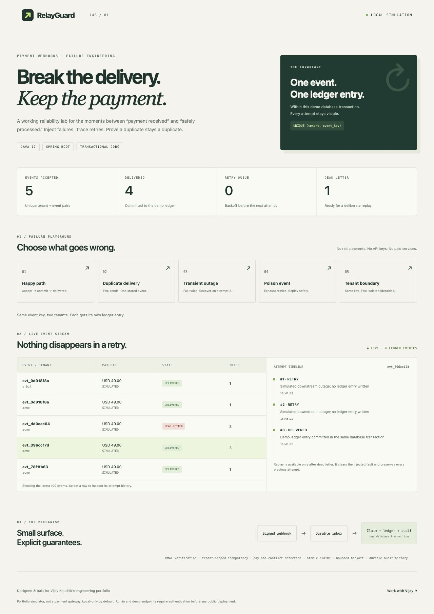
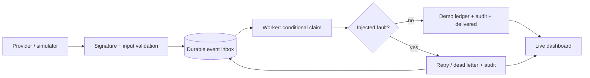

# RelayGuard

### Payment webhooks, deliberately broken. Recovery, made visible.

A runnable Java/Spring Boot engineering lab demonstrating how a payment webhook can be retried, duplicated, or isolated by tenant without creating an extra demo ledger entry.

Built for [Vijay Kaushik's engineering portfolio](https://www.upwork.com/freelancers/~015af8c955239d96f0). Original portfolio code, developed with AI assistance and validated through integration tests. No employer code, customer data, real payment credentials, or paid APIs.



## Try it in two minutes

Requires **Java 17+ and Maven 3.6.3+**. The first Maven run downloads public dependencies. No cloud account, database installation, Docker, or payment provider is required.

```sh
mvn verify
java -jar target/relayguard-1.0.0.jar
```

Open **http://127.0.0.1:8080**. A file-backed H2 database is created under `data/` (ignored by Git).

1. **Duplicate delivery:** two identical receives resolve to one event identity.
2. **Transient outage:** two injected failures precede a successful third attempt.
3. **Poison event:** three failures move the event into dead letter; inspect the timeline, clear the simulated outage, and replay.
4. **Tenant boundary:** one provider event key is accepted independently for two tenants.
5. Watch the live counters and select an event to inspect each delivery attempt.

The scheduler checks every two seconds; retries become eligible after two and four seconds. Execution may occur later than eligibility. Replay preserves historical attempt numbering.

## Why this project exists

A provider may send the same webhook repeatedly. A downstream dependency may fail after an incoming event has been accepted. A retry can silently become a second side effect if the design only handles the happy path.

RelayGuard makes these failure paths inspectable. Instead of a generic CRUD demo, it shows the database constraints, conditional update, and transaction boundary behind a concrete reliability guarantee.



## What is implemented

| Concern | Implementation | Evidence |
|---|---|---|
| Duplicate intake | Unique `(tenant, event_key)` constraint | Concurrent intake test: 16 submissions, one identity |
| Payload conflict | SHA-256 of the exact original JSON bytes | Same key + changed body returns 409 |
| Webhook authenticity | HMAC-SHA256 on exact request body | Missing signature and changed body return 401 |
| Concurrent consumers | Conditional database update claims a due event | Concurrent worker test: one claim, one ledger row |
| Partial failure | Claim, ledger write, audit and final state in one transaction | Forced database failure rolls back all changes |
| Bounded recovery | Three automatic attempts, exponential eligibility delay | Controlled-clock backoff test |
| Operator recovery | Dead-letter-only replay, retained audit history | Replay succeeds after injected outage is cleared |
| Durability | File-backed H2 for local runs | No in-memory event queue |

The **one-ledger-entry guarantee is local to this database transaction**. No external payment is charged, refunded, or transferred. This is not a claim of exactly-once execution across a real remote payment provider.

## API

| Method | Path | Purpose |
|---|---|---|
| POST | `/api/webhooks/{tenant}` | Accept a signed payment event |
| GET | `/api/events` | Latest 100 events, across demo tenants |
| GET | `/api/metrics` | Counts of stored events, states and ledger entries |
| GET | `/api/events/{id}/attempts` | Ordered attempt history |
| POST | `/api/events/{id}/replay` | Requeue dead letter and clear injected fault |
| POST | `/api/demo/{scenario}` | Run `success`, `duplicate`, `retry`, `poison` or `tenant` |

Signed body example:

```json
{"eventId":"evt_order_1042","amountMinor":4900,"currency":"USD"}
```

Set `X-Relay-Signature` to the lowercase hexadecimal HMAC-SHA256 of the exact body using `RELAYGUARD_WEBHOOK_SECRET`. The local demonstration secret is `local-demo-secret-change-me`. A successful first submission returns 202; an identical duplicate returns 200 with `duplicate: true`.

For a quick UI scenario without computing a signature:

```sh
curl -X POST http://127.0.0.1:8080/api/demo/duplicate
```

## Tests and CI

```sh
mvn verify
```

The repository includes 12 integration tests using a real H2 database, Spring transactions, concurrent calls, and MockMvc. No mocked database or network payment service is used. `mock-maker-subclass` avoids Mockito's self-attachment requirement on restricted local JVMs. GitHub Actions and a Bitbucket Pipelines configuration run the same Maven verification command; their remote run status must be checked on the hosting service.

## Design tradeoffs and boundaries

- **Local portfolio simulator.** Binds to `127.0.0.1` by default. Demo/read/replay endpoints intentionally have no authentication. Do not expose this application on a public network without replacing that boundary.
- **Tenant identity is demonstrated, not access control.** Idempotency is tenant-scoped; the dashboard intentionally shows all demo tenants. A production system needs authenticated tenant context, tenant-specific secrets and authorization on every read and replay.
- **H2 only.** SQL and transaction tests target H2. A PostgreSQL migration needs schema changes, duplicate-key transaction handling and database-specific concurrency tests.
- **Exact-body conflict detection.** Semantically equivalent JSON with different whitespace is treated as a different payload under the same event key. That is deliberate and documented rather than silently canonicalizing provider input.
- **No external delivery.** The downstream is a simulated ledger in the same database. For remote delivery, use an outbox plus downstream idempotency, a retry budget with jitter, and reconciliation; do not extend a local transaction across network calls.
- **No public production claims.** Authentication, timestamped signature rotation, ingress rate/body limits, retention, secret management and operational alerting remain deployment work.

Read the [architecture notes](docs/architecture.md) and [client walkthrough](docs/client-walkthrough.md).

## Work with Vijay

Available **5-10 hours/week** for Java/Spring Boot fixes, REST API integrations, backend troubleshooting and technical mentoring.

[Discuss a scoped task on Upwork](https://www.upwork.com/freelancers/~015af8c955239d96f0).
